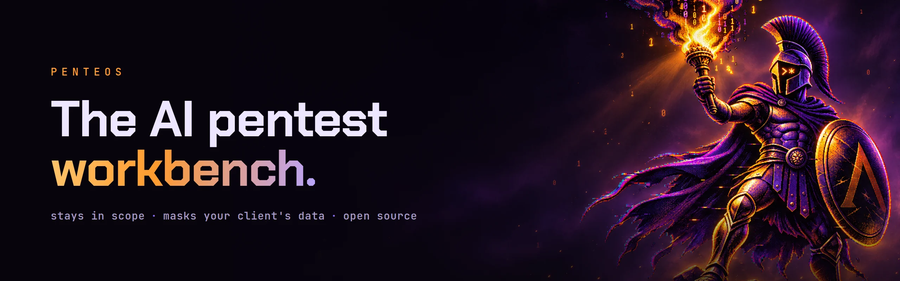
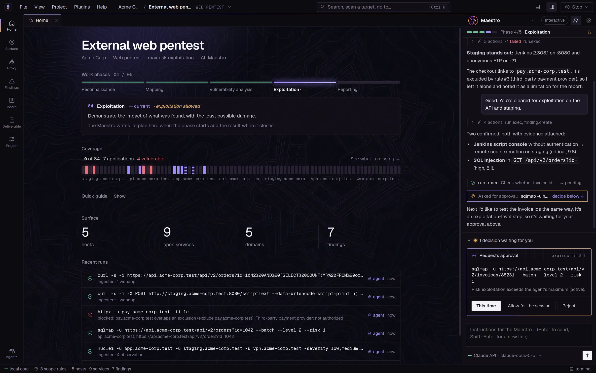
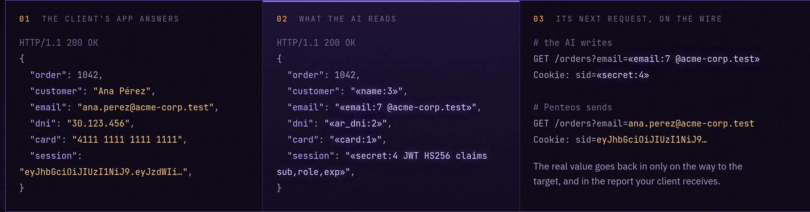

<p align="center">
  
</p>

<p align="center">
  <b>Recon to report in one place, with an agent that stays in scope<br>and masks your client's data before the AI reads it.</b>
</p>

<p align="center">
  <a href="LICENSE"></a>
  <a href="https://github.com/penteos/penteos/releases/latest"></a>
  <a href="https://github.com/penteos/penteos/actions/workflows/ci.yml"></a>
  
</p>

<p align="center">
  <a href="https://penteos.com">Website</a> ·
  <a href="#install">Install</a> ·
  <a href="#three-rules-it-cannot-break">How it works</a> ·
  <a href="SECURITY.md">Security</a> ·
  <a href="CONTRIBUTING.md">Contributing</a>
</p>

<br>

<p align="center">
  
</p>

Penteos is a desktop workbench for penetration testing. Scope, recon, real tools, an intercepting
proxy, evidence, findings and the client report live in one project. Its AI agent, the **Maestro**,
does the legwork next to you under three rules it cannot break.

## Install

Linux, x86_64 and arm64. No Docker, and Penteos and its tools run as your user.

```sh
curl -fsSL https://github.com/penteos/penteos/releases/latest/download/install.sh | sh
```

It picks the right package for your distribution and checks it against the release's `SHA256SUMS`
before installing anything. Add `-s -- --appimage` to install the AppImage in `~/.local/bin`
without root. Prefer to download by hand:

| Package | For |
|---|---|
| **AppImage** (recommended) | Any distribution, one file |
| `.deb` | Debian, Ubuntu, Kali, Mint, Pop!_OS |
| `.rpm` | Fedora, RHEL, Rocky, openSUSE |
| `.tar.gz` | Arch and everything else |

From [Releases](https://github.com/penteos/penteos/releases/latest):

```sh
chmod +x penteos-0.1.0-x86_64.AppImage && ./penteos-0.1.0-x86_64.AppImage
# or, on Debian and Ubuntu
sudo apt install ./penteos-0.1.0-amd64.deb
```

Every file ships with a checksum: `sha256sum -c SHA256SUMS`.

## Three rules it cannot break

### 1. Your client's data is masked before the AI reads it

Every response from the target passes through Penteos before the model sees it. Names, e-mails,
national IDs, cards, tokens and clinical notes become stable pseudonyms, and Penteos puts the real
value back only on the way to the target. The agent can use a value without ever reading it, and
the report your client receives is complete.

<p align="center">
  
</p>

Measured, not promised: 240 synthetic values in 17 kinds of data, served as JSON, database rows,
logs, HTML, CSV and free text. With masking off all 240 reach the model; with it on, none do.
Run it yourself with `pnpm privacy:measure`. What it does not catch yet is listed in
[SECURITY.md](SECURITY.md#known-limits).

### 2. Out of scope is impossible

The scope is enforced by the core, not by asking a model nicely. You, the agent, a plugin or an
external MCP client: every action goes through the same gate, for every tool, the proxy and the
browser. Hosts, ports and time windows are checked, and anything above the risk ceiling you set
waits for your approval with the exact command.

### 3. No proof, no finding

The agent runs real tools (nmap, httpx, nuclei, sqlmap and more) and reads their real output. Every
finding points to the exact lines of raw output that prove it, a separate verifier tries to
reproduce it from scratch, and nothing reaches the report without your approval.

## Bring your AI

| Model | How |
|---|---|
| **ChatGPT** | Sign in with ChatGPT and the agent runs on the plan you already pay for |
| **DeepSeek** | An API key; low cost per run |
| **Local models** | Ollama, LM Studio, llama.cpp or vLLM; nothing leaves your machine |
| **Any OpenAI-compatible API** | Your endpoint and key |
| **Claude** | An API key, or your own installed Claude Code |

Same rules for every model. Any MCP client can also drive Penteos as an agent, with the same scope
and approvals.

## Also on the workbench

- **Autopilot** that keeps working inside your rules and collects every decision it needs in one inbox
- **Intercepting proxy and an in-scope browser**, with history, rules, a fuzzer and WebSockets
- **A verified tool catalog** installed in your user folder, each binary pinned to its SHA-256
- **CVE intelligence by version**, with what it would take to confirm each one
- **Out-of-band callbacks, retests and diffs** between engagements
- **Reports** in Word, PDF, HTML and Markdown, technical and executive, with your template
- **Plugins** with permissions and an isolated mode
- **Team server** (experimental): the same core, self-hosted, with operators and roles

## Build from source

Node 24 and pnpm:

```sh
pnpm install
pnpm dev
```

[CONTRIBUTING.md](CONTRIBUTING.md) covers the layout, the checks and how to add an operation.

## Responsible use

**Use Penteos only on systems you are authorized to test.** It enforces the scope you define; the
authorization is yours. See [RESPONSIBLE_USE.md](RESPONSIBLE_USE.md).

## License

Penteos is free software under the [GNU AGPL-3.0-or-later](LICENSE). "Penteos" and its logo are
trademarks of Santiago Habib; see [TRADEMARKS.md](TRADEMARKS.md).

<p align="center"><sub>Built by Santiago Habib · <a href="https://x.com/santihabibok">@santihabibok</a></sub></p>
